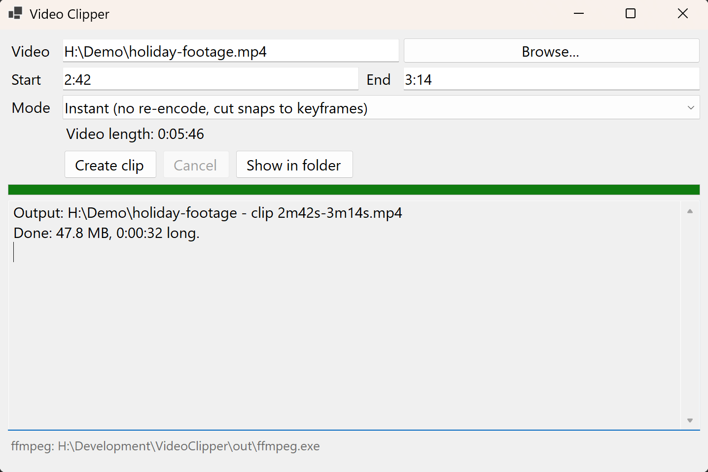

# Video Clipper

Cut a clip out of a video by typing a start and end time. No video editor, no timeline, no re-exporting.

Built for the "I just want the 30 seconds from the middle of this recording" job. Drop in a video, type `2:42` and `3:14`, click **Create clip**.



## Download

Get the latest installer from the [**Releases**](../../releases/latest) page, run it, and you're done. It includes everything it needs (including [FFmpeg](THIRD-PARTY-NOTICES.md)); nothing else to install.

> **Windows SmartScreen:** the installer isn't code-signed yet, so Windows may show "Windows protected your PC". Click **More info → Run anyway**.

Requires 64-bit Windows 10 or 11.

## How to use

1. **Video** - drag a file onto the window, click **Browse...**, or paste its path.
2. **Start / End** - type times as `30`, `0:30`, `2:42` or `1:02:03`. You can also paste a whole range like `00:30 -> 9:39` into **Start** and it splits itself across both boxes. **End** fills in with the video's length automatically.
3. **Mode** - pick how to cut (see below).
4. Click **Create clip**. The clip is saved next to the original as `<name> - clip 2m42-3m14.mp4`; the original is never touched. **Show in folder** jumps to it.

### Modes

| Mode | What it does | Use it when |
|---|---|---|
| **Instant** (default) | Copies the video without re-encoding. Takes a second or two and loses no quality. The cut snaps to the nearest keyframe, so it can start a little earlier than the time you typed. | A rough cut is fine - e.g. you leave a few seconds of buffer anyway. |
| **Accurate** | Re-encodes the video (using your GPU's H.264 encoder when available) so the clip starts and ends exactly where you said. Slower. | Frame-exact start and end matter. |

Audio is always copied as-is.

## Build from source

Needs the [.NET 10 SDK](https://dotnet.microsoft.com/download). Place an `ffmpeg.exe` next to the project (or have one on your `PATH`), then:

```powershell
dotnet run
```

The release installer is built by [GitHub Actions](.github/workflows/release.yml): pushing a tag like `v1.0.0` downloads a pinned, checksum-verified official FFmpeg LGPL build, publishes the app as a self-contained single file, builds the installer with [Inno Setup](https://jrsoftware.org/isinfo.php), and attaches it to a GitHub Release.

## Licence

Video Clipper is released under the [MIT licence](LICENSE). It runs FFmpeg (LGPL v2.1+) as a separate program - see [THIRD-PARTY-NOTICES.md](THIRD-PARTY-NOTICES.md).
